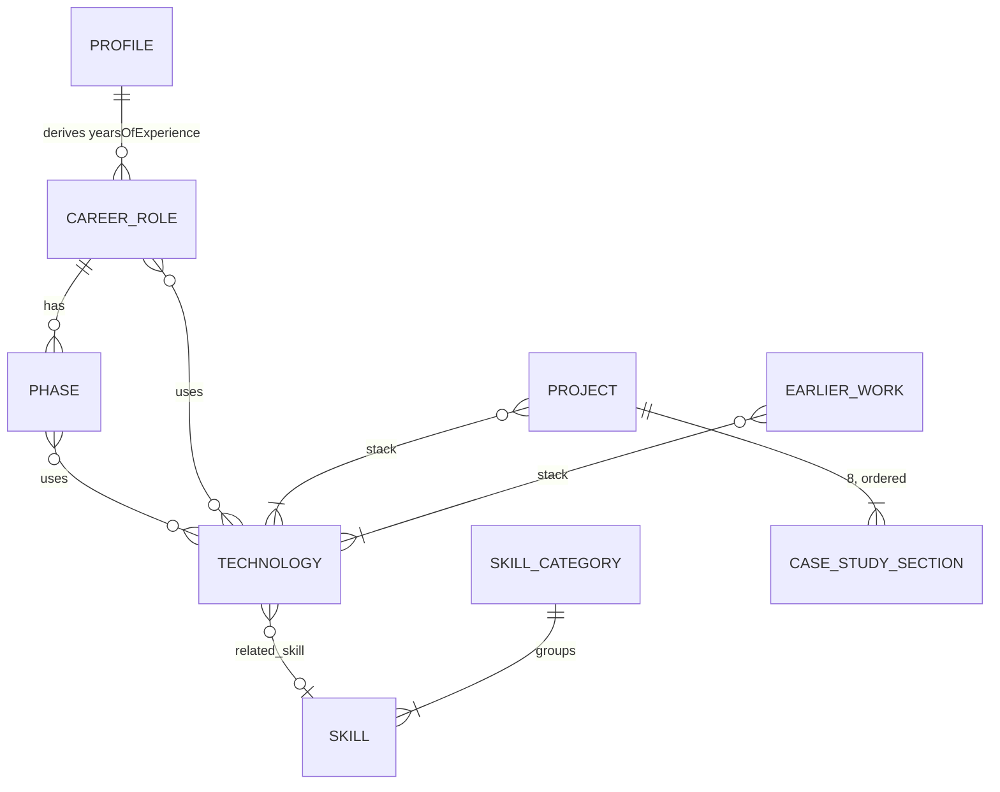

# Data Model: Portfolio Personale

**Feature**: [spec.md](./spec.md) | **Schemi**: [contracts/content-schemas.md](./contracts/content-schemas.md)

Tutti i dati sono letti da `content/` a build-time. Non esistono scritture, sessioni o stati
persistiti lato server. L'unico stato a runtime è nel browser: filtro e ricerca (nell'URL).
Questo documento descrive le entità, le relazioni e i campi derivati; tipi e regole esatte sono in
[content-schemas.md](./contracts/content-schemas.md).

## Mappa sorgenti → entità

| File | Entità | Cardinalità |
|---|---|---|
| `content/about.md` | Profile | 1 |
| `content/career.yaml` | CareerRole (+ Phase, Progression) | ≥ 1 |
| `content/earlier-work.yaml` | EarlierWork | ≥ 0 |
| `content/skills.yaml` | Skill raggruppate in SkillCategory | 8 categorie, ≥ 1 skill ciascuna |
| `content/technologies.yaml` | Technology | ≥ 1 |
| `content/projects/*.md` | Project (+ CaseStudySection ×8) | ≥ 0 |
| `content/how-i-use-ai.md` *(nuovo)* | AiWorkflowPage | 1 |
| `content/assets/**` | Asset (immagini) | ≥ 0 |

## Entità

### Profile

| Campo | Tipo | Note |
|---|---|---|
| name, title, location | string | obbligatori |
| email | email | usato per `mailto:` (FR-009) e nel CV |
| links.linkedin, links.github | URL https | footer, CV, JSON-LD `sameAs` |
| summary | string ≤ 300 | *nuovo, obbligatorio*; bio breve: hero della home, CV, meta description |
| availability | string? | mostrato in /about; senza offerte di servizi (spec, Fuori scope) |
| avatar | AssetPath? | *nuovo, opzionale*; fallback iniziali |
| spoken_languages | {name, level}[] ≥ 1 | *nuovo, obbligatorio*; level ∈ native, professional, intermediate, basic; /about e CV |
| body | markdown | bio lunga (/about) |

**Derivati**
- `yearsOfExperience`: `floor(mesi tra il CareerRole.start più vecchio e la data di build / 12)`.
  Con i dati attuali (2019-05-06 → 2026-10-03) = 7.

### CareerRole

| Campo | Tipo | Note |
|---|---|---|
| role, company, location, type, summary | string | obbligatori |
| company_url | URL? | |
| start | `YYYY-MM` o `YYYY-MM-DD` | |
| end | come start, oppure `null` | `null` = ruolo in corso ("present") |
| responsibilities, achievements, ai_work, notes | string[]? | mostrati nel dettaglio espandibile |
| phases | Phase[]? | label, period, client_sector, tech[] |
| progression | Progression[]? | title, focus |
| tech | TechSlug[]? | |

**Regole**: `end ≥ start`; almeno uno tra `tech` e `phases` presente.
**Derivati**: `techAll` = unione deduplicata di `tech` e `phases[].tech`, nell'ordine di prima
apparizione; `isCurrent = end === null`.
**Ordinamento**: per `start` decrescente nel codice (il file è già ordinato, ma l'ordine non è
affidato al file).

### EarlierWork

| Campo | Tipo | Note |
|---|---|---|
| title, company, sector, role, summary | string | |
| period | Period (`<inizio> → <fine\|present>`) | es. `2019 → 2020` |
| stack | TechSlug[] (≥ 1) | |

**Derivati**: `anchorId = "earlier-" + slugify(title)`, unico (la build fallisce sui duplicati);
`periodEnd`/`periodStart` come chiavi di ordinamento (`present` = +∞, `~2023` = 2023).
**Ordinamento**: per `periodEnd` decrescente, a parità `periodStart` decrescente. La home mostra le
prime 4 (FR-001, FR-005).

### Skill e SkillCategory

- **SkillCategory**: una delle 8 chiavi fisse `languages, frameworks, cloud, databases, devops,
  messaging, ai, testing`, nell'ordine di visualizzazione.
- **Skill**: `name` (unico in tutto il file), `level` (`expert > advanced > intermediate > basic`),
  opzionali `since`, `period`, `versions`, `notes`, `services[]`, `highlight` (default `false`).

**Derivati**: `primaryStack` = skill con `highlight: true`, nell'ordine delle categorie e del
file (FR-001). Devono essere da 1 a 8 (regola X10).

### Technology

| Campo | Tipo | Note |
|---|---|---|
| slug | kebab-case, unico | chiave usata negli `stack` e nel parametro `tech` |
| name | string | etichetta mostrata |
| category | `language\|framework\|database\|cloud\|devops\|messaging\|ai\|testing` | raggruppa le opzioni del filtro |
| related_skill | Skill.name o `null` | link skill → progetti filtrati (US-06) |

### Project

| Campo | Tipo | Note |
|---|---|---|
| slug | dal nome file, kebab-case | `/projects/<slug>` |
| title, subtitle, role, sector | string | |
| year | intero, ≤ anno di build | ordinamento, `pubDate` RSS |
| stack | TechSlug[] (≥ 1) | |
| featured | boolean | home (FR-001) |
| repo, demo | URL https o `null` | link mostrati solo se non nulli (US-04) |
| cover, cover_alt | AssetPath?, string? | *nuovi, opzionali*; `cover_alt` obbligatorio se `cover` |
| sections | CaseStudySection ×8 | dal body |

**CaseStudySection**: `{ id, title, markdown, plainText }`. Titoli ammessi, in quest'ordine
esatto: Context, Problem, Solution, My role, Technical decisions, Trade-offs, Impact,
What I'd do differently. `id` = slug del titolo (ancora della navigazione interna, US-03).

**Ordinamento**: `year` decrescente, poi `title`.
**Featured in home**: tutti i `featured: true`; se nessuno, i 3 più recenti (edge case della spec).

### AiWorkflowPage *(nuovo file di contenuto)*

`content/how-i-use-ai.md`: frontmatter `title`, `description` (meta description),
`spec_links[]` (`label`, `path` relativo alla root del repo); body markdown.
**Regola**: ogni `path` deve esistere nel repo al momento della build. I link vengono resi come
`REPO_URL/blob/main/<path>` (FR-008, SC-008).

### SearchItem *(derivato, solo client)*

Vista uniforme di Project ed EarlierWork passata a `ProjectExplorer`.

| Campo | Project | EarlierWork |
|---|---|---|
| kind | `"case-study"` | `"earlier-work"` |
| id | slug | anchorId |
| href | `/projects/<slug>` | `/projects#<anchorId>` |
| title, subtitle | title, subtitle | title, company |
| sector, role | ✓ | ✓ |
| summary | Context (testo semplice, troncato a 280 caratteri) | summary |
| stack | slug[] + nomi mostrati | slug[] + nomi mostrati |
| body | testo semplice delle 8 sezioni | — |
| sortKey | year | periodEnd |

## Relazioni

**Integrità referenziale** (la build fallisce se violata):
- ogni slug in `Project.stack`, `EarlierWork.stack`, `CareerRole.tech`, `Phase.tech` esiste in
  `technologies.yaml`;
- ogni `Technology.related_skill` non nullo corrisponde a uno `Skill.name`;
- `Technology.slug`, `Skill.name`, `Project.slug`, `EarlierWork.anchorId` sono unici;
- ogni `AssetPath` esiste in `content/assets/` e rispetta formato e peso.

## Stati

Nessuna entità ha transizioni di stato: il contenuto è pubblicato se e solo se la build passa. Non
esiste lo stato "bozza": un case study incompleto resta fuori da `content/projects/` (FR-003).
Stato client effimero: `{ tech: Set<TechSlug>, q: string }`, serializzato nell'URL (vedi
[ui-contracts.md](./contracts/ui-contracts.md)).
