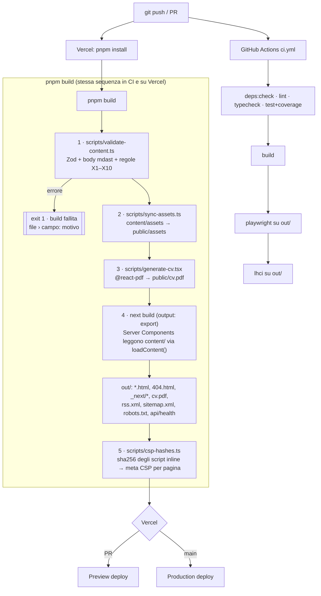

# Implementation Plan: Portfolio Personale

**Branch**: `001-personal-portfolio` (non ancora creato: la directory non è un repository git) |
**Date**: 2026-10-03 | **Spec**: [spec.md](./spec.md)

**Input**: Feature specification from `specs/001-personal-portfolio/spec.md`

## Summary

Sito portfolio statico per Francesco Marrara: home, elenco progetti con filtro e ricerca, case
study in 8 sezioni, about con timeline e skill, pagina "How I use AI", CV in PDF, RSS, sitemap.
È un'unica applicazione Next.js 16 (App Router) con `output: 'export'`, deployata su Vercel Hobby
tramite l'integrazione GitHub. I contenuti in `content/` sono letti e validati con Zod a
build-time: un errore di schema o una sezione mancante fanno fallire la build. Ricerca e filtro
girano nel browser con Fuse.js e lo stato vive nell'URL. Il CV è generato con
`@react-pdf/renderer` prima di `next build`. Gli header di sicurezza stanno in `vercel.json`,
perché `headers()` non funziona con l'export statico. La CSP usa hash per pagina calcolati dopo la
build. Costo: 0 €/mese.

## Technical Context

**Language/Version**: TypeScript 5.x in modalità `strict`, Node.js 24 LTS (build e tooling)

**Primary Dependencies**: Next.js 16 (App Router, static export), React 19, Tailwind CSS v4,
shadcn/ui (Radix), Zod 4, gray-matter + yaml, Fuse.js, react-markdown + remark-gfm +
mdast-util-from-markdown, @react-pdf/renderer, @vercel/analytics

**Storage**: N/A. File in `content/` (git) letti a build-time; nessun database

**Testing**: Vitest + @testing-library/react (jsdom), @vitest/coverage-v8; Playwright +
@axe-core/playwright; Lighthouse CI (@lhci/cli)

**Target Platform**: browser evergreen (ultime 2 versioni di Chrome, Firefox, Safari, Edge,
incluse le versioni mobile); hosting statico Vercel CDN

**Project Type**: sito web statico (single project, nessun backend)

**Performance Goals**: Lighthouse ≥ 95 ×4 su ogni route; LCP < 2.5 s, CLS < 0.1, INP < 200 ms su
4G; budget indicativo di JavaScript iniziale per route ≤ 150 KB gzip, da tarare sulla prima
build (serve a tenere margine sul punteggio Performance)

**Constraints**: compatibile con `output: 'export'` (nessun SSR, ISR, proxy o route handler
dinamico); 0 €/mese; nessuna variabile d'ambiente né secret; nessuna feature AI runtime;
nessun account oltre a GitHub e Vercel

**Scale/Scope**: 5 tipologie di route, ~10 pagine generate oggi (2 case study), < 50 voci
ricercabili nel medio periodo; traffico da portfolio personale (ben sotto i limiti Hobby: 100 GB
transfer, 50k eventi Analytics/mese)

Nessuna voce resta `NEEDS CLARIFICATION`: le incognite sono risolte in [research.md](./research.md).

## Constitution Check

*GATE: Must pass before Phase 0 research. Re-check after Phase 1 design.*

Riferimento: constitution **v2.0.0** (emendata in questa sessione: framework Next.js 15 → 16,
vedi research R1).

| # | Principio / Vincolo | Esito | Evidenza nel design |
|---|---|---|---|
| I | Statico e Semplice (NON NEGOZIABILE) | ✅ PASS | `output: 'export'`, un solo codebase e un solo deploy; nessun DB, API o servizio long-running. `/api/health` è un file statico generato in build. Nessuna feature AI runtime |
| II | Costo Zero, Manutenzione Zero | ✅ PASS | Vercel Hobby + GitHub Actions su repo pubblico; contatto `mailto:`; nessun dominio custom. Rischio R-02 (uso commerciale) da presidiare |
| III | Contenuto Prima dell'Estetica | ✅ PASS | `content/` unica fonte di verità; 8 sezioni obbligatorie verificate in build; CV derivato da `career.yaml` + `skills.yaml` + `earlier-work.yaml` + `about.md` |
| IV | AI Agentica come Metodo | ✅ PASS | `specs/` versionato; `/how-i-use-ai` linka gli artefatti; sezione README dedicata |
| V | Qualità del Codice e Test | ✅ PASS | Vitest + Playwright; ESLint + Prettier + TS strict; coverage ≥ 80% su tutto il codice TypeScript (`src/**`, `scripts/**`), pagine incluse; `no-warning-comments` blocca i TODO |
| VI | Performance e Accessibilità | ✅ PASS | Lighthouse CI con soglia 0.95 in CI; axe su ogni route; font di sistema; JS limitato alle isole interattive |
| VII | Sicurezza | ✅ PASS | Header via `vercel.json` (non `next.config.ts`, vedi R2); CSP con hash, senza `unsafe-inline` per gli script; Dependabot; nessun secret; checklist OWASP nel template PR |
| VIII | Manutenibilità | ✅ PASS | CI lint/typecheck/test/build/E2E/LHCI; `CHANGELOG.md` SemVer; `docs/dependencies.md` con controllo in CI |
| — | Lingua | ✅ PASS | UI e contenuti in inglese, commenti nel codice in inglese, documenti in `specs/` e `docs/` in italiano. US-11 fuori dalla v1 |
| — | Mobile-first | ✅ PASS | Stili base per 360px, breakpoint verso l'alto; E2E su viewport mobile |
| — | Framework Next.js 16 | ✅ PASS | Dopo l'emendamento v2.0.0 |
| — | Tailwind CSS + shadcn/ui | ✅ PASS | Tailwind v4, componenti shadcn in `src/components/ui/` |
| — | Layout `content/ specs/ src/ public/` | ✅ PASS | Presenti tutte e quattro; `scripts/`, `tests/`, `docs/`, `.github/` sono directory di supporto e non sostituiscono quelle richieste |
| — | Workflow (specify → plan → tasks, preview su PR) | ✅ PASS | Questo plan; preview Vercel su ogni PR; template PR con self-review |

**Gate pre-design: PASS.**

## Project Structure

### Documentation (this feature)

```text
specs/001-personal-portfolio/
├── spec.md                      # /speckit-specify
├── plan.md                      # questo file
├── research.md                  # Phase 0
├── data-model.md                # Phase 1
├── quickstart.md                # Phase 1
├── contracts/
│   ├── content-schemas.md       # schemi Zod di tutti i file di content/
│   └── ui-contracts.md          # route, query string, comportamenti, header, CSP
├── checklists/
│   └── requirements.md          # /speckit-specify
└── tasks.md                     # /speckit-tasks (non creato qui)
```

### Source Code (repository root)

```text
.
├── .github/
│   ├── workflows/ci.yml                 # lint, typecheck, test, build, e2e, lhci
│   ├── dependabot.yml                   # npm + github-actions, settimanale
│   └── pull_request_template.md         # self-review: principi I–VIII + checklist OWASP Top 10
├── content/                             # ESISTENTE — fonte di verità
│   ├── about.md
│   ├── career.yaml
│   ├── earlier-work.yaml
│   ├── skills.yaml
│   ├── technologies.yaml
│   ├── how-i-use-ai.md                  # NUOVO (contenuto da scrivere, vedi R-08)
│   ├── projects/
│   │   ├── agentic-ai-transition.md
│   │   └── mobility-services-backend.md
│   └── assets/
├── docs/
│   ├── dependencies.md                  # registro con data di review (Principio VIII)
│   └── security.md                      # CSP: policy, eccezioni motivate
├── public/
│   ├── cv.pdf                           # GENERATO, in .gitignore
│   └── assets/                          # COPIATO da content/assets, in .gitignore
├── scripts/
│   ├── validate-content.ts              # pnpm content:check
│   ├── sync-assets.ts                   # content/assets → public/assets
│   ├── generate-cv.tsx                  # public/cv.pdf
│   ├── cv/
│   │   ├── cv-document.tsx              # componenti @react-pdf
│   │   ├── styles.ts
│   │   └── fonts/Inter-{Regular,SemiBold}.ttf   # OFL
│   ├── csp-hashes.ts                    # post-build: <meta> CSP per pagina in out/
│   └── check-dependency-registry.ts     # pnpm deps:check
├── specs/                               # artefatti Spec Kit
├── src/
│   ├── app/
│   │   ├── layout.tsx                   # html lang="en", header, footer, <Analytics/>
│   │   ├── icon.svg                     # convenzione Next: <link rel="icon"> automatico
│   │   ├── globals.css                  # Tailwind v4 + token shadcn
│   │   ├── page.tsx                     # /
│   │   ├── not-found.tsx                # 404.html
│   │   ├── projects/
│   │   │   ├── page.tsx                 # /projects (Suspense + ProjectExplorer)
│   │   │   └── [slug]/page.tsx          # generateStaticParams, dynamicParams = false
│   │   ├── about/page.tsx
│   │   ├── how-i-use-ai/page.tsx
│   │   ├── rss.xml/route.ts             # force-static
│   │   ├── api/health/route.ts          # force-static
│   │   ├── sitemap.ts                   # force-static
│   │   └── robots.ts                    # force-static
│   ├── components/
│   │   ├── ui/                          # shadcn: button, badge, input (checkbox nativi, vedi R5)
│   │   ├── layout/
│   │   │   ├── site-header.tsx
│   │   │   ├── nav-links.tsx            # client: aria-current
│   │   │   ├── mobile-nav.tsx           # <details>, funziona senza JS
│   │   │   ├── site-footer.tsx
│   │   │   └── skip-link.tsx
│   │   └── sections/
│   │       ├── hero.tsx
│   │       ├── featured-projects.tsx
│   │       ├── project-card.tsx
│   │       ├── earlier-work-list.tsx
│   │       ├── career-timeline.tsx
│   │       ├── career-role.tsx          # <details>/<summary>, funziona senza JS
│   │       ├── spoken-languages.tsx
│   │       ├── skills-grid.tsx
│   │       ├── project-list.tsx         # server: card + earlier work (fallback e lista filtrata)
│   │       ├── project-explorer.tsx     # client: filtro + ricerca + URL
│   │       ├── tech-filter.tsx          # client
│   │       ├── search-box.tsx           # client
│   │       ├── case-study.tsx
│   │       ├── case-study-toc.tsx
│   │       ├── project-links.tsx        # repo/demo solo se non nulli
│   │       ├── tech-badge-list.tsx
│   │       ├── markdown-content.tsx     # react-markdown, niente HTML raw
│   │       ├── spec-links.tsx
│   │       ├── contact-link.tsx
│   │       ├── cv-download-link.tsx
│   │       └── json-ld.tsx
│   └── lib/
│       ├── schemas.ts                   # Zod (contracts/content-schemas.md)
│       ├── content.ts                   # loadContent(contentDir), cache per build
│       ├── cross-checks.ts              # regole X1–X10
│       ├── markdown.ts                  # mdast: sezioni, plain text, validazione body
│       ├── derive.ts                    # anni esperienza, primaryStack, ordinamenti, periodi
│       ├── search.ts                    # SearchItem, filtro OR, opzioni Fuse
│       ├── url-state.ts                 # parse/serialize di ?tech&q
│       ├── seo.ts                       # metadata, JSON-LD Person/TechArticle
│       ├── rss.ts                       # build XML RSS 2.0
│       ├── slug.ts
│       ├── site.ts                      # SITE_URL, REPO_URL (costanti, niente env)
│       └── utils.ts                     # cn() di shadcn
├── tests/
│   ├── fixtures/content/                # dataset minimo valido; i casi non validi sono derivati nei test
│   ├── setup/
│   │   ├── dom.ts                       # jest-dom per il progetto jsdom
│   │   └── app.ts                       # mock di @/lib/content (fixture), next/navigation, @vercel/analytics/next
│   ├── unit/
│   │   ├── lib/                         # schemas, content, cross-checks, markdown, derive, search, url-state, seo, rss
│   │   ├── components/                  # Testing Library (jsdom)
│   │   ├── app/                         # pagine, layout e route handler (node, renderToStaticMarkup)
│   │   └── scripts/                     # validate-content, sync-assets, generate-cv, csp-hashes, check-dependency-registry
│   └── e2e/
│       ├── home.spec.ts
│       ├── about.spec.ts
│       ├── navigation.spec.ts
│       ├── projects-filter.spec.ts      # include la misura di INP sul filtro
│       ├── projects-search.spec.ts
│       ├── projects-no-js.spec.ts
│       ├── case-study.spec.ts
│       ├── cv-download.spec.ts
│       ├── contact.spec.ts
│       ├── how-i-use-ai.spec.ts
│       ├── not-found.spec.ts
│       ├── seo-files.spec.ts            # sitemap, robots, rss, health, JSON-LD
│       ├── security.spec.ts             # meta CSP, nessuna violazione
│       ├── a11y.spec.ts                 # axe su ogni route
│       ├── links.spec.ts                # link interni da sitemap, frammenti inclusi
│       └── fixtures.ts                  # blocco /_vercel/**, listener CSP violations
├── CHANGELOG.md
├── README.md                            # setup, architettura, sezione "Built with AI agents"
├── components.json                      # shadcn
├── eslint.config.mjs
├── lighthouserc.json
├── next.config.ts                       # output: 'export', images.unoptimized, trailingSlash: false
├── package.json
├── playwright.config.ts
├── postcss.config.mjs
├── prettier.config.mjs
├── tsconfig.json
├── vercel.json                          # header HTTP (ui-contracts §7)
├── vitest.config.mts
└── .nvmrc
```

**Structure Decision**: un solo progetto Next.js alla radice, come richiesto dal Principio I. Le
pagine in `src/app/` contengono solo composizione: caricano i dati con `loadContent()` e li passano
a componenti sincroni in `src/components/`, testabili con Testing Library. Tutta la logica
(validazione, derivazioni, ricerca, URL, SEO, RSS) sta in `src/lib/` come funzioni pure. Gli
script di build in `scripts/` riusano `src/lib/`, quindi sito e CV hanno una sola fonte di verità.
I loader ricevono `contentDir` come parametro, così i test usano `tests/fixtures/content/` senza
variabili d'ambiente.

## Flusso di build



## Compatibilità con `output: 'export'`: cosa cambia rispetto al brief

Dettaglio e fonti in [research.md R2](./research.md#r2-compatibilità-con-output-export).

| Punto del brief | Problema | Soluzione nel plan |
|---|---|---|
| Header in `next.config.ts` | **Non compatibile**: `headers()` non è supportato con l'export statico, gli header verrebbero ignorati senza errore | `vercel.json` |
| CV in `postbuild` dentro `public/` | **Non funziona**: `public/` è già stato copiato in `out/` | Generazione prima di `next build` |
| CSP | Il nonce non è disponibile (serve rendering per richiesta) | Hash per pagina post-build |
| `/api/health` | Compatibile solo con `force-static`; il file in `out/` non ha estensione | `Content-Type` forzato in `vercel.json` |
| `next/image` | Il loader di default non è supportato | `images.unoptimized: true` + limite di peso in validazione |
| `src/data/search-index.json` | Compatibile ma superfluo | Dati passati come props al Client Component (R6) |
| Query params | Leggibili solo lato client | `useSearchParams` in `<Suspense>` con fallback statico completo |

## Script npm

| Script | Comando |
|---|---|
| `dev` | `tsx scripts/sync-assets.ts && tsx scripts/generate-cv.tsx && next dev` |
| `content:check` | `tsx scripts/validate-content.ts` |
| `build` | `pnpm content:check && tsx scripts/sync-assets.ts && tsx scripts/generate-cv.tsx && next build && tsx scripts/csp-hashes.ts` |
| `serve` | `serve out -l 3000` |
| `lint` | `eslint . && prettier --check .` |
| `format` | `prettier --write .` |
| `typecheck` | `next typegen && tsc --noEmit` |
| `test` | `vitest run --coverage` |
| `test:e2e` | `playwright test` (webServer: `pnpm serve`) |
| `lhci` | `mkdir -p out/_vercel/insights && touch out/_vercel/insights/script.js && lhci autorun` (`staticDistDir: ./out`; lo stub vuoto evita il 404 dello script di Analytics fuori da Vercel, R-18) |
| `deps:check` | `tsx scripts/check-dependency-registry.ts` |

La catena è esplicita in `build` invece di usare gli hook `prebuild`/`postbuild`: così il
comportamento non dipende dalla configurazione di pnpm e Vercel esegue esattamente `pnpm build`.

## Strategie di generazione

### CV PDF (FR-006, US-07)

- Input: `loadContent()` → Profile, CareerRole[], EarlierWork[], Skills. Stessi schemi del sito.
- Layout A4, una colonna, font Inter registrato da file locale (glifi `→`, `—`, `~`).
- Sezioni: Header (nome, titolo, località, email, LinkedIn, GitHub) · Profile (`summary`) ·
  Experience (ruoli con periodo, summary, responsabilità/achievements, tecnologie) · Earlier work
  (una riga per voce: titolo, azienda, periodo, stack) · Skills (per categoria, con livello) ·
  Languages (`spoken_languages`, obbligatorio).
- Output: `public/cv.pdf`; metadata PDF `title`, `author`, `subject`.
- Test: render in memoria con dataset di fixture → il buffer inizia con `%PDF-`, ha più di 0 byte e
  il testo estratto contiene nome e primo ruolo.

### RSS (FR-011)

Route handler `force-static` che usa `src/lib/rss.ts` (funzione pura, testata): RSS 2.0 con escape
XML di tutti i campi, `atom:link rel="self"`, item ordinati per anno decrescente.

### Sitemap, robots, JSON-LD (FR-010)

`sitemap.ts` e `robots.ts` con `force-static`, URL assoluti da `SITE_URL`. JSON-LD generato da
`src/lib/seo.ts`: `Person` (name, jobTitle, email, url, sameAs, knowsAbout = primaryStack) su `/` e
`/about`; `TechArticle` (headline, description, author, datePublished = anno, keywords = stack) sui
case study. Contratto completo in [ui-contracts.md](./contracts/ui-contracts.md).

## CI/CD

`.github/workflows/ci.yml`, su `pull_request` e `push` a `main`, runner `ubuntu-latest`, Node 24:

1. `pnpm install --frozen-lockfile` (con cache pnpm)
2. `pnpm deps:check`
3. `pnpm lint`
4. `pnpm typecheck`
5. `pnpm test` (coverage ≥ 80%, report caricato come artifact)
6. `pnpm build`
7. `pnpm exec playwright install --with-deps chromium` + `pnpm test:e2e` (report come artifact se fallisce)
8. `pnpm lhci` (tutte le pagine; categorie ≥ 0.95 e soglie su LCP, CLS, TBT; 3 run per URL)

Deploy: integrazione GitHub di Vercel, preview su ogni PR e produzione su `main`. Nessun deploy
manuale e nessun token Vercel in GitHub. Branch protection su `main`: CI verde obbligatoria.
Rispetto al brief sono stati aggiunti `deps:check` e `lhci` (servono ai Principi VIII e VI) e
Prettier dentro `lint` (Principio V).

## Strategia di test per componente

| Componente / modulo | Tipo | Cosa si verifica |
|---|---|---|
| `lib/schemas.ts` | unit | Ogni schema accetta i contenuti reali e le fixture; rifiuta chiavi sconosciute, URL http, date malformate, periodi malformati, livelli non validi |
| `lib/markdown.ts` | unit | Divisione in 8 sezioni; errori per sezione mancante, vuota, fuori ordine, duplicata, extra, H1, HTML raw; apostrofo tipografico normalizzato; plain text |
| `lib/cross-checks.ts` | unit | X1–X10, un test per regola con messaggio atteso |
| `lib/content.ts` | unit | Caricamento di `tests/fixtures/content`; aggregazione di più errori in un `ContentValidationError`; date YAML lasciate come stringhe |
| `lib/derive.ts` | unit | Anni di esperienza (bordi: mese esatto, giorno mancante); `primaryStack` da `highlight`; ordinamento ruoli, earlier work (`present`, `~`), progetti; fallback featured |
| `lib/search.ts` | unit | Filtro OR; ricerca case-insensitive e parziale; parole oltre i primi 100 caratteri trovate (`ignoreLocation`); intersezione filtro ∩ ricerca; nessun risultato |
| `lib/url-state.ts` | unit | Parse/serialize round-trip; normalizzazione (ordine, duplicati, trim, limite 100); slug ignoti scartati; `q` < 2 caratteri |
| `lib/seo.ts`, `lib/rss.ts` | unit | JSON-LD valido con escape di `<`; RSS ben formato con escape XML |
| `scripts/csp-hashes.ts` | unit | Hash corretto su HTML di esempio; JSON-LD escluso; `<meta>` primo figlio di `<head>`; errore su `style=` non ammesso |
| `scripts/generate-cv.tsx` | unit | PDF generato da fixture (header `%PDF-`, testo atteso, incluse le lingue parlate) |
| `scripts/check-dependency-registry.ts` | unit | Pacchetto mancante → errore; data non ISO → errore; review > 12 mesi → warning |
| `hero`, `featured-projects`, `earlier-work-list`, `skills-grid`, `case-study`, `case-study-toc`, `tech-badge-list`, `contact-link`, `site-header`, `site-footer` | component | Render con dati finti; link e ancore corretti; repo/demo assenti non renderizzati; `aria-current`; livello skill come testo |
| `career-role` | component | `<details>` con `<summary>` (azienda, ruolo, periodo); `open` solo sul ruolo corrente; dettaglio nel DOM anche da chiuso, con tutti i campi presenti |
| `src/app/**` | unit (node) | Pagine e layout renderizzati con `renderToStaticMarkup` su contenuti di fixture (mock di `@/lib/content`, `next/navigation`, `@vercel/analytics/next`); `GET()` dei route handler; `sitemap()`, `robots()`, `generateStaticParams()`, `generateMetadata()` |
| `project-explorer`, `tech-filter`, `search-box` | component | Interazione utente → lista filtrata, contatore `aria-live`, stato vuoto con "Clear filters", Escape svuota la ricerca, `router.replace` chiamato con URL normalizzato (router mockato) |
| Navigazione globale, 404 | E2E | Tutte le voci di menu su desktop e mobile, anche senza JS (`<details>`) |
| Filtro, ricerca, deep link | E2E | Scenari V6–V9 di [quickstart.md](./quickstart.md) |
| Case study | E2E | 8 sezioni, indice, link stack → `/projects?tech=` |
| Download CV | E2E | Risposta 200 `application/pdf`, file non vuoto con header `%PDF-` |
| SEO, health | E2E | sitemap con tutte le route, robots, RSS parsabile, `/api/health` con il body atteso |
| Accessibilità | E2E | axe (tag `wcag2a`, `wcag2aa`, `wcag21aa`) su ogni route, desktop e mobile: zero violazioni |
| Link interni | E2E | Ogni `a[href^="/"]` di ogni URL della sitemap risponde 200 |
| CSP | E2E (fixture) | Nessun evento `securitypolicyviolation` su nessuna route |
| Performance | LHCI | Tutte le pagine di `out/` (`maxAutodiscoverUrls: 0`); ≥ 0.95 su Performance, Accessibility, Best Practices, SEO; LCP ≤ 2500 ms, CLS ≤ 0.1, TBT ≤ 200 ms |
| INP | E2E | Interazioni con filtro e ricerca < 200 ms con CPU rallentata 4× (Event Timing API) |

## Registro dipendenze iniziale

`docs/dependencies.md` parte con queste voci, data di review = data della prima installazione.
Le versioni sono fissate dal lockfile al momento dell'implementazione.

- **prod**: next, react, react-dom, zod, gray-matter, yaml, fuse.js, react-markdown, remark-gfm,
  mdast-util-from-markdown, mdast-util-to-string, @vercel/analytics, radix-ui, class-variance-authority,
  clsx, tailwind-merge, lucide-react
- **dev**: typescript, @types/node, @types/react, @types/react-dom, tailwindcss,
  @tailwindcss/postcss, eslint, eslint-config-next, prettier, prettier-plugin-tailwindcss, vitest,
  @vitest/coverage-v8, jsdom, @testing-library/react, @testing-library/user-event,
  @testing-library/jest-dom, @playwright/test, @axe-core/playwright, @lhci/cli, serve, tsx,
  @react-pdf/renderer, unpdf (estrazione del testo del CV nei test)

## Stima costi

| Voce | Piano | Limite incluso | Uso previsto | Costo |
|---|---|---|---|---|
| Hosting + CDN | Vercel Hobby | 100 GB Fast Data Transfer, 1M richieste CDN | < 1 GB/mese (sito < 1 MB per visita completa) | 0 € |
| Build e deploy | Vercel Hobby | 100 deploy/giorno | < 10/giorno | 0 € |
| Web Analytics | Vercel Hobby | 50.000 eventi/mese; oltre, la raccolta si sospende senza addebiti | < 5.000 | 0 € |
| Dominio | `*.vercel.app` | — | — | 0 € (un dominio custom costerebbe ~10 €/anno: escluso, Principio II) |
| CI | GitHub Actions, repo pubblico | minuti illimitati per repo pubblici | ~8 min per run | 0 € |
| Dependabot | GitHub | incluso | — | 0 € |
| Font Inter (CV) | OFL | — | — | 0 € |
| **Totale** | | | | **0 €/mese** |

Nessuna delle funzionalità usate prevede addebiti automatici su Hobby: superati i limiti, il
servizio si sospende, non viene fatturato.

## Rischi e mitigazioni

| ID | Rischio | Prob. | Impatto | Mitigazione |
|---|---|---|---|---|
| R-01 | Next.js 15 a fine supporto il 2026-10-21 | — | Alto | **Risolto**: constitution v2.0.0, piano su Next.js 16. Il registro dipendenze (review ≤ 12 mesi) fa emergere per tempo la prossima scadenza |
| R-02 | Vercel Hobby vieta l'uso commerciale ("advertising the sale of a product or service") | Bassa dopo il chiarimento | Alto (sospensione dell'account o passaggio a Pro, in conflitto con il Principio II) | **Deciso in `/speckit-clarify`**: solo profilo professionale, offerte di servizi fuori scope, persona P4 = contatto professionale. Resta da riformulare `availability` in `about.md` senza "consulting". Self-review delle PR: nessun testo promozionale |
| R-03 | Header in `next.config.ts` ignorati senza errore con l'export statico | Alta se non gestito | Alto (nessun HSTS/CSP) | `vercel.json`; verifica V17 su ogni preview; test E2E che controlla il `<meta>` CSP |
| R-04 | La CSP con hash rompe l'idratazione (script inline non coperti) o diventa fragile ai cambi di Next | Media | Alto | Lo script hash-a tutti gli inline di ogni pagina; listener `securitypolicyviolation` negli E2E; procedura di fallback documentata in `docs/security.md` |
| R-05 | Gli attributi `style=` di Radix/shadcn richiedono `style-src-attr 'unsafe-inline'` (il `Checkbox` di Radix li genera già in SSR, nell'input nascosto) | Media | Basso | La build fallisce se compaiono; checkbox nativi al posto di quello di shadcn; eventuale eccezione limitata a `style-src-attr` e motivata |
| R-06 | CV generato nel momento sbagliato (postbuild) → PDF vecchio in produzione | Alta se non gestito | Medio (SC-003) | Generazione prima di `next build`; `public/cv.pdf` in `.gitignore`; scenario V11 |
| R-07 | Caratteri non resi nel PDF (`→`) con i font standard | Alta se non gestito | Medio | Inter TTF registrato; test del testo estratto; scenario V10 |
| R-08 | Contenuti mancanti che bloccano la build: `content/how-i-use-ai.md`; in `about.md` i campi `summary` e `spoken_languages`; in `skills.yaml` nessun `highlight`. Non bloccanti: body di `about.md` breve per una bio lunga, nessun avatar, `repo: null` in entrambi i progetti | Certa | Medio | Primo task dell'implementazione: aggiornare `content/` (elenco in [content-schemas.md](./contracts/content-schemas.md#stato-rispetto-ai-contenuti-attuali)). Raccomandato: espandere il body di `about.md` |
| R-09 | Stack principale in home troppo lungo o non rappresentativo | Bassa | Medio | **Deciso in `/speckit-clarify`**: skill con `highlight: true`, da 1 a 8, controllato in build (X10) |
| R-10 | La bio dice "7 years" a testo fisso, mentre il valore calcolato diventa 8 a maggio 2027 | Certa nel tempo | Basso | Togliere il numero dalla bio; il valore calcolato si aggiorna a ogni deploy |
| R-11 | Aprire un link filtrato causa un riordino della lista dopo l'idratazione (CLS) | Media | Basso | Controlli presenti nel fallback; la lista filtrata è più corta, quindi niente salta in basso; Lighthouse misura `/projects` senza parametri |
| R-12 | Risultati Fuse rumorosi o mancanti nel testo lungo | Media | Basso | `ignoreLocation`, `threshold` 0.35, test con query reali sui contenuti |
| R-13 | Lighthouse instabile in CI | Media | Basso | 3 run e mediana; soglia sulle 4 categorie; performance verificata anche su produzione (V19) |
| R-14 | Vercel Toolbar sui preview bloccata dalla CSP | Alta | Basso | Disattivare la toolbar nelle impostazioni del progetto o accettare l'errore solo sui preview (la produzione non la carica) |
| R-15 | `gray-matter` non riceve aggiornamenti da anni | Bassa | Basso | Usato tramite wrapper in `content.ts` con engine `yaml`; sostituibile da uno split del frontmatter senza toccare il resto |
| R-16 | `SITE_URL` sbagliato → sitemap, canonical e RSS errati | Media | Medio | Costante unica, impostata al primo deploy (quickstart); test E2E che confronta canonical e sitemap |
| R-17 | pnpm 10 blocca gli script di install di alcune dipendenze (es. binari nativi) | Media | Basso | `pnpm.onlyBuiltDependencies` esplicito in `package.json` |
| R-18 | Fuori da Vercel `/_vercel/insights/script.js` risponde 404: errore in console e Best Practices sotto 0.95 in LHCI | Alta se non gestito | Medio | Gli E2E intercettano `/_vercel/**`; lo script `lhci` crea uno stub vuoto in `out/` locale, che non viene mai deployato |
| R-19 | LHCI con `staticDistDir` analizza al massimo 5 pagine di default | Certa se non gestito | Alto (route non misurate, Principio VI) | `maxAutodiscoverUrls: 0` in `lighthouserc.json` |

## Constitution Check (post-design)

Rivalutazione dopo research, data model e contratti:

| # | Esito | Note dopo il design |
|---|---|---|
| I | ✅ PASS | Nessun componente richiede un server; tutte le route e i file sono nell'export |
| II | ✅ PASS | Costo 0 € verificato voce per voce; R-02 resta un rischio da presidiare, non una violazione |
| III | ✅ PASS | Lo schema impone le 8 sezioni; nuovo file di contenuto `how-i-use-ai.md`, sempre in `content/` |
| IV | ✅ PASS | `spec_links` validati in build: un artefatto rinominato rompe la build invece di generare link morti |
| V | ✅ PASS | Coverage su tutto il codice TypeScript, pagine incluse (test con `renderToStaticMarkup` su contenuti di fixture) |
| VI | ✅ PASS | Fallback del Suspense con controlli disabilitati per CLS; LHCI e axe in CI |
| VII | ✅ PASS | Nessun `unsafe-inline`/`unsafe-eval` per gli script; HTML raw del markdown disattivato; link esterni `noopener noreferrer`; nessun input inviato a un server |
| VIII | ✅ PASS | Registro con controllo automatico; CHANGELOG |
| Vincoli | ✅ PASS | Next.js 16, Tailwind + shadcn, inglese per i visitatori, mobile-first |

**Gate post-design: PASS.** Nessuna violazione non giustificata.

## Complexity Tracking

| Scostamento | Perché serve | Alternativa più semplice scartata perché |
|---|---|---|
| CSP su due livelli (header + `<meta>` per pagina) con uno script post-build | Unico modo di avere una CSP senza `unsafe-inline` con l'export statico | `script-src 'unsafe-inline'` è più semplice, ma è proprio ciò che il Principio VII chiede di evitare |
| Lighthouse CI e controllo del registro dipendenze aggiunti alla CI del brief | Rendono verificabili in automatico i Principi VI e VIII | Le verifiche manuali non bloccano un merge |
